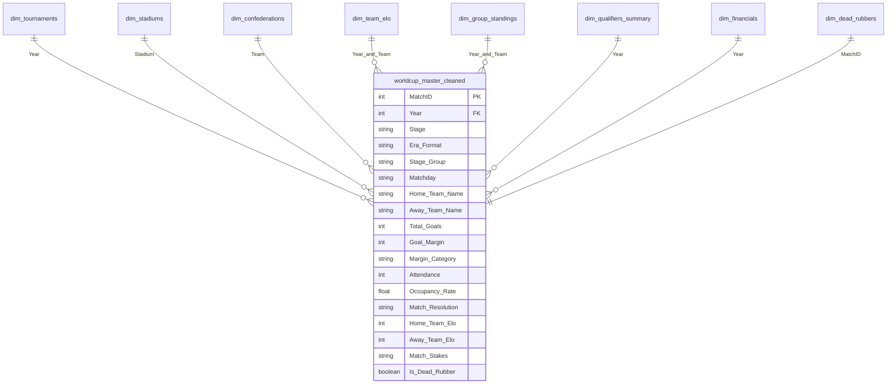

# 🏆 FIFA WORLD CUP (1930 - 2026): TOURNAMENT EXPANSION & GLOBAL APPEAL

> **Đề tài:** *Nghiên cứu tác động của việc mở rộng quy mô giải đấu qua 4 kỷ nguyên thể thức (16 $\to$ 24 $\to$ 32 $\to$ 48 đội) tới sức hút thương mại, tính cạnh tranh chuyên môn và tính toàn cầu hóa của FIFA World Cup.*  
> **Vai trò phụ trách:** **Data Engineer** (Thu thập, Làm sạch, Biến đổi đặc trưng, Kiểm định chất lượng & Xây dựng Master Dataset).

---

## 📌 HƯỚNG DẪN DÀNH CHO CÁC THÀNH VIÊN VẼ BIỂU ĐỒ (VISUALIZERS)

> [!IMPORTANT]
> **Dành cho 3 thành viên làm slide và biểu đồ:**  
> Các bạn **CHỈ CẦN LÀM VIỆC TRONG THƯ MỤC [`production/`](file:///home/na/code/fifaWorldCup/production)**. Toàn bộ dữ liệu tại đây đã được làm sạch 100%, khử trùng lặp và đạt điểm kiểm định tuyệt đối **100/100 (Hạng A+)**.

### 1. Nạp dữ liệu trong 1 dòng code Python:
```python
import pandas as pd

# 1. Bảng dữ liệu chính (1.068 trận đấu lịch sử + mô phỏng 2026, 52 cột)
df = pd.read_csv('production/worldcup_master_cleaned.csv')

# 2. Bảng tổng hợp 23 kỳ World Cup (QualifiedTeams, Attendance, Occupancy)
dim_tourn = pd.read_csv('production/dim_tournaments.csv')

# 3. Bảng sức chứa 217 sân vận động
dim_stad = pd.read_csv('production/dim_stadiums.csv')

# 4. Bảng 90 đội tuyển & liên đoàn châu lục (UEFA, CONMEBOL, AFC, CAF, CONCACAF, OFC)
dim_conf = pd.read_csv('production/dim_confederations.csv')

# 5. Bảng điểm Elo & Xếp hạng thế giới (537 đội qua 23 kỳ - eloratings.net)
dim_elo = pd.read_csv('production/dim_team_elo.csv')

# 6. Bảng xếp hạng Vòng bảng & Hạt giống knock-out (510 bản ghi bảng đấu)
dim_standings = pd.read_csv('production/dim_group_standings.csv')

# 7. Bảng quy mô Vòng loại qua các thời kỳ (23 kỳ - 1930 đến 2026)
dim_qual = pd.read_csv('production/dim_qualifiers_summary.csv')

# 8. Bảng tài chính & quỹ tiền thưởng FIFA (23 chu kỳ - FIFA Financial Reports)
dim_fin = pd.read_csv('production/dim_financials.csv')

# 9. Bảng chi tiết 249 trận Matchday 3 & Phân loại tính chất thủ tục
dim_dead = pd.read_csv('production/dim_dead_rubbers.csv')
```

### 2. Các tài liệu quan trọng bạn cần mở:
* 📊 **Dashboard kiểm thử chất lượng (Mở trên trình duyệt):** [`production/data_quality_report.html`](file:///home/na/code/fifaWorldCup/production/data_quality_report.html)
* 📖 **Từ điển dữ liệu & Code mẫu vẽ biểu đồ cho từng người:** [`production/DATA_DICTIONARY.md`](file:///home/na/code/fifaWorldCup/production/DATA_DICTIONARY.md)
* 📈 **Biểu đồ Skewness 4 chỉ số (Dùng chèn vào slide):** [`production/skewness_distributions.png`](file:///home/na/code/fifaWorldCup/production/skewness_distributions.png)
* 📓 **Notebook kiểm tra dữ liệu tương tác:** [`production/inspect_data_quality.ipynb`](file:///home/na/code/fifaWorldCup/production/inspect_data_quality.ipynb)

---

## 👥 PHÂN CÔNG CỘT DỮ LIỆU CHO 3 THÀNH VIÊN

| Thành viên | Trụ cột nghiên cứu | Các cột trọng yếu cần dùng | Mục tiêu biểu đồ (Deliverables) |
| :--- | :--- | :--- | :--- |
| **Thành viên 1** | **Sức hút Thương mại & Khán đài** | `Era_Format`, `Attendance`, `Max_Capacity`, `Occupancy_Rate`, `Stage_Group` | • **Baseline:** Combo Chart (Số trận đấu vs Khán giả TB qua 4 kỷ nguyên).<br>• **Deep-dive:** Boxplot tỷ lệ lấp đầy sân (`Occupancy_Rate`) để bóc tách biến nhiễu sân vận động khổng lồ của Mỹ. |
| **Thành viên 2** | **Tính Cạnh tranh & Kịch tính** | `Goal_Margin`, `Margin_Category`, `Total_Goals`, `Matchday` | • **Baseline:** Stacked Bar Chart (% Trận sát nút $\le 1$ bàn vs Trận hủy diệt $\ge 4$ bàn).<br>• **Deep-dive:** Phân tích lượt trận cuối vòng bảng (`Matchday 3`) để kiểm chứng có xuất hiện "trận đấu thủ tục" không. |
| **Thành viên 3** | **Cấu trúc Knockout & Toàn cầu hóa** | `Match_Resolution`, `Is_Extra_Time`, `Is_Penalties`, `Home_Confederation`, `Away_Confederation` | • **Baseline:** Tỷ lệ trận phải đá hiệp phụ/luân lưu qua 4 kỷ nguyên.<br>• **Deep-dive:** Ma trận/Heatmap giao lưu giữa các liên đoàn mới (AFC, CAF) với các ông lớn (UEFA, CONMEBOL). |

---

## 🏛️ MÔ HÌNH DỮ LIỆU HÌNH SAO (STAR SCHEMA)

Bộ dữ liệu được thiết kế theo chuẩn **Star Schema** trong Data Warehouse, với bảng sự kiện trung tâm [`worldcup_master_cleaned.csv`](file:///home/na/code/fifaWorldCup/production/worldcup_master_cleaned.csv) và **8 bảng chiều dữ liệu vệ tinh (Dimension Tables)**:



---

## 📊 DANH MỤC & MÔ TẢ CHI TIẾT TẤT CẢ 9 BẢNG DỮ LIỆU (DATA CATALOG)

Toàn bộ 9 bảng dữ liệu thành phẩm đã được kiểm định đạt điểm tuyệt đối **100/100 (Grade A+)** và lưu trữ sẵn sàng tại thư mục [`production/`](file:///home/na/code/fifaWorldCup/production):

```text
1. Bảng Sự kiện Trung tâm (Fact Table):
   └── worldcup_master_cleaned.csv   (1.068 dòng × 57 cột)

2. Bảng Chiều Bổ trợ (Dimension Tables):
   ├── dim_tournaments.csv           (23 dòng × 9 cột)   - Tổng quan 23 kỳ giải đấu
   ├── dim_stadiums.csv              (217 dòng × 7 cột)  - Sân vận động, thành phố, sức chứa
   ├── dim_confederations.csv        (90 dòng × 3 cột)   - Phân loại 6 liên đoàn bóng đá châu lục
   ├── dim_team_elo.csv              (537 dòng × 6 cột)  - Điểm Elo Ratings & Xếp hạng thế giới
   ├── dim_group_standings.csv       (510 dòng × 13 cột) - Bảng xếp hạng Vòng bảng & Hạt giống
   ├── dim_qualifiers_summary.csv    (23 dòng × 7 cột)   - Quy mô Vòng loại & Toàn cầu hóa
   ├── dim_financials.csv            (23 dòng × 10 cột)  - Doanh thu chu kỳ 4 năm & Tiền thưởng FIFA
   └── dim_dead_rubbers.csv          (249 dòng × 16 cột) - Chi tiết 249 trận Matchday 3 & Trận thủ tục
```

---

### 1️⃣ BẢNG SỰ KIỆN TRUNG TÂM: [`worldcup_master_cleaned.csv`](file:///home/na/code/fifaWorldCup/production/worldcup_master_cleaned.csv)
* **Vai trò:** Fact Table lưu trữ toàn bộ các trận đấu trong lịch sử giải đấu và mô phỏng 2026.
* **Quy mô:** **1.068 dòng $\times$ 57 cột**. Khóa chính: `MatchID`.
* **Phân nhóm các trường thông tin:**

#### A. Định danh trận đấu & Địa điểm tổ chức
| Tên cột | Kiểu dữ liệu | Mô tả chi tiết | Dữ liệu mẫu | Phục vụ |
| :--- | :---: | :--- | :--- | :---: |
| `MatchID` | Int | Khóa chính (PK) duy nhất của trận đấu (1 đến 1068). | `1`, `500`, `1068` | Toàn bộ |
| `RoundID` | Int | Mã định danh vòng đấu chính thức của FIFA. | `201`, `1323` | Phân loại |
| `Year` | Int | Năm diễn ra kỳ World Cup (1930 đến 2026). Khóa ngoại $\to$ `dim_tournaments`. | `1930`, `1994`, `2026` | Cả nhóm |
| `Datetime` | Datetime | Thời gian thi đấu chuẩn quốc tế ISO 8601 `YYYY-MM-DD HH:MM:SS`. | `1994-07-17 12:30:00` | Sắp xếp |
| `Country` | String | Quốc gia đăng cai giải đấu. | `USA`, `Qatar`, `France` | Cả nhóm |
| `City` | String | Thành phố nơi diễn ra trận đấu. | `Pasadena`, `Rio De Janeiro` | Địa lý |
| `Stadium` | String | Tên sân vận động đã làm sạch ký tự lạ. Khóa ngoại $\to$ `dim_stadiums`. | `Rose Bowl`, `Maracanã` | TV1 |
| `Referee`, `Assistant 1`, `Assistant 2` | String | Tổ trọng tài điều khiển trận đấu. | `Sándor Puhl`, `Pierluigi Collina` | Tra cứu |

#### B. Đội tuyển & Bàn thắng cơ bản
| Tên cột | Kiểu dữ liệu | Mô tả chi tiết | Dữ liệu mẫu | Phục vụ |
| :--- | :---: | :--- | :--- | :---: |
| `Home Team Name`, `Away Team Name` | String | Tên hai đội tuyển đối đầu (đã chuẩn hóa lỗi mã hóa). | `Brazil`, `Italy`, `Germany` | Cả nhóm |
| `Home Team Goals`, `Away Team Goals` | Int | Bàn thắng trong 90 phút chính thức + hiệp phụ. | `0`, `1`, `7` | TV2 |
| `Half-time Home Goals`, `Half-time Away Goals` | Float | Tỷ số kết thúc hiệp 1. | `0.0`, `1.0`, `5.0` | TV2 |
| `Winner` | String | Đội thắng cuộc chính thức (đã phân giải dứt điểm loạt luân lưu). | `Brazil`, `Draw` (Vòng bảng) | TV2, TV3 |
| `Win conditions` | String | Diễn biến đặc biệt nguyên bản (`a.e.t.`, `penalties`). | `Brazil win on penalties (3 - 2)` | Kiểm tra |

#### C. Kỷ nguyên & Phân đoạn Thể thức
| Tên cột | Kiểu dữ liệu | Mô tả chi tiết | Dữ liệu mẫu | Phục vụ |
| :--- | :---: | :--- | :--- | :---: |
| `Era_Format` | Categorical | 4 Kỷ nguyên thể thức: `16 Teams (1930-1978)`, `24 Teams (1982-1994)`, `32 Teams (1998-2022)`, `48 Teams (2026)`. | `32 Teams (1998-2022)` | **Trục chính** |
| `Stage` | String | Tên vòng đấu nguyên bản (`Group A`, `Round of 16`, `Final`). | `Group E`, `Semi-finals` | Phân tích |
| `Stage_Group` | Categorical | 3 phân đoạn chuẩn: `1. Group Stage`, `2. Early Knockout` (R32/R16), `3. Deep Knockout` (Tứ kết $\to$ Chung kết). | `1. Group Stage` | **TV1 & TV3** |
| `Stage_Detail` | Categorical | Chi tiết: `First Group Stage`, `Second Group Stage` (1974/78/82), `Early Knockout`, `Deep Knockout`. | `First Group Stage` | Bổ trợ |
| `Matchday` | Categorical | Lượt trận vòng bảng: `Matchday 1`, `Matchday 2`, `Matchday 3`, `Matchday 3/4 Play-off`, `Not Group Stage`. | `Matchday 3` | **TV2** |

#### D. Khoảng cách Tỷ số & Kịch tính Vòng bảng
| Tên cột | Kiểu dữ liệu | Mô tả chi tiết | Dữ liệu mẫu | Phục vụ |
| :--- | :---: | :--- | :--- | :---: |
| `Total_Goals` | Int | Tổng bàn thắng trong trận = Home + Away. | `0`, `2`, `8` | TV2 |
| `Goal_Margin` | Int | Độ chênh lệch tỷ số tuyệt đối = $\lvert \text{Home Goals} - \text{Away Goals} \rvert$. | `0`, `1`, `6` | TV2 |
| `Margin_Category` | Categorical | 3 nhóm cách biệt: `1. Sat Nut / Hoa (<=1 ban)`, `2. Cach Biet (2 ban)`, `3. Thang Dam (>=3 ban)`. | `1. Sat Nut / Hoa (<=1 ban)` | **TV2 Stacked** |

#### E. Hiệp phụ & Cấu trúc Knock-out
| Tên cột | Kiểu dữ liệu | Mô tả chi tiết | Dữ liệu mẫu | Phục vụ |
| :--- | :---: | :--- | :--- | :---: |
| `Match_Resolution` | Categorical | Phân loại 4 kịch bản kết quả: `1. Normal Time - Blowout (>=2)`, `2. Normal Time - Close (<=1)`, `3. Extra Time`, `4. Penalties`. | `4. Penalties` | **TV3 Knockout** |
| `Is_Extra_Time` | Boolean | `True` nếu trận đấu kéo dài qua 90 phút vào Hiệp phụ. | `True`, `False` | TV3 |
| `Is_Penalties` | Boolean | `True` nếu trận đấu giải quyết bằng sút luân lưu 11m. | `True`, `False` | TV3 |
| `Is_Golden_Goal` | Boolean | `True` nếu trận đấu kết thúc bằng Bàn thắng vàng (1998, 2002). | `True`, `False` | TV3 Annotate |

#### F. Sức hút Khán đài & Khử nhiễu Sân bãi
| Tên cột | Kiểu dữ liệu | Mô tả chi tiết | Dữ liệu mẫu | Phục vụ |
| :--- | :---: | :--- | :--- | :---: |
| `Attendance` | Float | Số lượng khán giả theo dõi thực tế (100% không rỗng). | `94194.0`, `43063.0` | **TV1 Khán đài** |
| `Max_Capacity` | Int | Sức chứa tối đa của sân vận động tổ chức. | `94194`, `74738` | TV1 |
| `Capacity_Source` | Categorical | Nguồn sức chứa: `Official_Or_Historical` vs `Imputed_From_Attendance`. | `Official_Or_Historical` | TV1 |
| `Occupancy_Rate` | Float (%) | Tỷ lệ lấp đầy sân = $(\text{Attendance} / \text{Max\_Capacity}) \times 100\%$. | `100.0`, `92.4` | **TV1 Boxplot** |

#### G. Địa lý & Liên đoàn Châu lục
| Tên cột | Kiểu dữ liệu | Mô tả chi tiết | Dữ liệu mẫu | Phục vụ |
| :--- | :---: | :--- | :--- | :---: |
| `Home_Confederation`, `Away_Confederation` | String | Liên đoàn châu lục: `UEFA`, `CONMEBOL`, `CONCACAF`, `CAF`, `AFC`, `OFC`. | `UEFA`, `CONMEBOL` | **TV3 Heatmap** |
| `Home_Team_Unified`, `Away_Team_Unified` | String | Tên quốc gia đã thống nhất lịch sử (Đức Tây $\to$ Đức). | `Germany`, `Russia` | Liên kết |

#### H. Điểm số Sức mạnh & Đẳng cấp Elo
| Tên cột | Kiểu dữ liệu | Mô tả chi tiết | Dữ liệu mẫu | Phục vụ |
| :--- | :---: | :--- | :--- | :---: |
| `Home_Team_Elo`, `Away_Team_Elo` | Int | Điểm World Football Elo Ratings của hai đội ngay trước giải. | `2088`, `1974` | **TV2 & TV3** |
| `Home_Team_World_Rank`, `Away_Team_World_Rank` | Int | Thứ hạng thế giới theo Elo ngay trước giải đấu. | `1`, `4`, `32` | Phân hạng |
| `Elo_Diff` | Int | Chênh lệch điểm đẳng cấp = $\lvert \text{Home\_Elo} - \text{Away\_Elo} \rvert$. | `114`, `350` | **TV2 Scatter** |
| `Underdog_Team`, `Favorite_Team` | String | Tên đội cửa dưới (Elo thấp hơn) và đội cửa trên (Elo cao hơn). | `Italy`, `Brazil` | TV3 |
| `Is_Upset` | Boolean | `True` nếu đội cửa dưới thắng hoặc loại đội cửa trên. | `True`, `False` | **TV3 Địa chấn** |

#### I. Hạt giống Vòng bảng & Kịch bản Knock-out
| Tên cột | Kiểu dữ liệu | Mô tả chi tiết | Dữ liệu mẫu | Phục vụ |
| :--- | :---: | :--- | :--- | :---: |
| `Home_Group_Rank`, `Away_Group_Rank` | Int | Thứ hạng vòng bảng của 2 đội (1: Nhất bảng, 2: Nhì bảng, 3: Ba vé vớt). | `1`, `2`, `3` | **TV3 Hạt giống** |
| `Matchup_Type` | Categorical | Phân loại kịch bản: `1. Winner vs Runner-up`, `2. Winner vs 3rd Place`, v.v. | `2. Winner vs 3rd Place` | **TV3 Vé vớt** |
| `Contains_Third_Placed_Team` | Boolean | `True` nếu trận knock-out có sự góp mặt của đội hạng 3 vé vớt. | `True`, `False` | TV3 Tử thủ |

#### J. Tính chất Lượt cuối Vòng bảng (Matchday 3)
| Tên cột | Kiểu dữ liệu | Mô tả chi tiết | Dữ liệu mẫu | Phục vụ |
| :--- | :---: | :--- | :--- | :---: |
| `Match_Stakes` | Categorical | 4 nhóm tính chất: `1. Both Qualified`, `2. Both Eliminated`, `3. One-sided Dead Rubber`, `4. Decisive / High Stakes`. | `4. Decisive / High Stakes` | **TV2 Thủ tục** |
| `Is_Dead_Rubber` | Boolean | `True` nếu trận đấu có bất kỳ yếu tố thủ tục nào. | `True`, `False` | TV2 |
| `Is_Full_Dead_Rubber` | Boolean | `True` nếu cả 2 đội đều đã an bài số phận trước giờ bóng lăn. | `True`, `False` | TV2 |
| `Home_Pre_Match_Status`, `Away_Pre_Match_Status` | Categorical | Trạng thái toán học trước Lượt 3: `Qualified`, `Eliminated`, `Contending`. | `Contending`, `Qualified` | TV2 Tâm lý |

---

### 2️⃣ BẢNG CHIỀU GIẢI ĐẤU: [`dim_tournaments.csv`](file:///home/na/code/fifaWorldCup/production/dim_tournaments.csv)
* **Vai trò:** Dimension Table tổng hợp các chỉ số vĩ mô của **23 kỳ World Cup** (1930 đến 2026).
* **Quy mô:** **23 dòng $\times$ 9 cột**. Khóa chính: `Year`.
* **Cấu trúc trường thông tin:**

| Tên cột | Kiểu dữ liệu | Mô tả chi tiết |
| :--- | :---: | :--- |
| `Year` | Int (PK) | Năm tổ chức giải đấu (1930, 1934, ..., 2026). |
| `Host_Country` | String | Quốc gia đăng cai chính thức. |
| `Era_Format` | Categorical | 4 Kỷ nguyên thể thức (16, 24, 32, 48 Teams). |
| `QualifiedTeams` | Int | Số lượng đội tuyển tham dự VCK (13, 16, 24, 32, 48). |
| `MatchesPlayed` | Int | Tổng số trận đấu đã diễn ra (17 trận năm 1934 $\to$ 104 trận năm 2026). |
| `Total_Goals` | Int | Tổng số bàn thắng được ghi trong toàn giải. |
| `Total_Attendance` | Int | Tổng số lượng khán giả theo dõi trực tiếp tại sân. |
| `Mean_Attendance` | Float | Khán giả trung bình trên mỗi trận đấu. |
| `Mean_Occupancy_Rate`| Float (%) | Tỷ lệ lấp đầy sân trung bình toàn giải đấu. |

---

### 3️⃣ BẢNG CHIỀU SÂN VẬN ĐỘNG: [`dim_stadiums.csv`](file:///home/na/code/fifaWorldCup/production/dim_stadiums.csv)
* **Vai trò:** Dimension Table lưu trữ thông tin cơ sở hạ tầng của **217 sân vận động** qua 23 kỳ.
* **Quy mô:** **217 dòng $\times$ 7 cột**. Khóa chính: `Stadium`.
* **Cấu trúc trường thông tin:**

| Tên cột | Kiểu dữ liệu | Mô tả chi tiết |
| :--- | :---: | :--- |
| `Stadium` | String (PK) | Tên sân vận động chính thức (đã khử mojibake và ký tự lạ). |
| `City` | String | Thành phố nơi đặt sân vận động. |
| `Host_Country` | String | Quốc gia sở tại. |
| `Max_Capacity` | Int | Sức chứa tối đa (chỗ ngồi) của sân vận động. |
| `Capacity_Source` | Categorical | Nguồn số liệu sức chứa: `Official_Or_Historical` vs `Imputed_From_Attendance`. |
| `Matches_Hosted` | Int | Số lượng trận đấu World Cup đã tổ chức tại sân này. |
| `Record_Attendance` | Int | Kỷ lục số khán giả đông nhất từng ghi nhận tại sân. |

---

### 4️⃣ BẢNG CHIỀU LIÊN ĐOÀN BÓNG ĐÁ: [`dim_confederations.csv`](file:///home/na/code/fifaWorldCup/production/dim_confederations.csv)
* **Vai trò:** Ánh xạ **90 đội tuyển quốc gia** tham dự World Cup vào 6 liên đoàn bóng đá châu lục.
* **Quy mô:** **90 dòng $\times$ 3 cột**. Khóa chính: `Team_Name`.
* **Cấu trúc trường thông tin:**

| Tên cột | Kiểu dữ liệu | Mô tả chi tiết |
| :--- | :---: | :--- |
| `Team_Name` | String (PK) | Tên đội tuyển nguyên bản trong lịch sử thi đấu. |
| `Unified_Team_Name`| String | Tên quốc gia đã chuẩn hóa thống nhất theo phân chia chính trị hiện đại (ví dụ: `Germany FR` $\to$ `Germany`, `Soviet Union` $\to$ `Russia`). |
| `Confederation` | Categorical | 6 liên đoàn bóng đá trực thuộc FIFA: `UEFA` (Châu Âu), `CONMEBOL` (Nam Mỹ), `CONCACAF` (Bắc Trung Mỹ & Caribe), `CAF` (Châu Phi), `AFC` (Châu Á), `OFC` (Châu Đại Dương). |

---

### 5️⃣ BẢNG CHIỀU ĐIỂM SỐ ELO: [`dim_team_elo.csv`](file:///home/na/code/fifaWorldCup/production/dim_team_elo.csv)
* **Vai trò:** Lưu trữ điểm số sức mạnh và bảng xếp hạng thế giới của toàn bộ các đội tuyển ngay trước ngày khai mạc của 23 kỳ World Cup (cào từ [*eloratings.net*](https://www.eloratings.net/)).
* **Quy mô:** **537 dòng $\times$ 6 cột**. Khóa ngoại: `(Year, Team_Name)`.
* **Cấu trúc trường thông tin:**

| Tên cột | Kiểu dữ liệu | Mô tả chi tiết |
| :--- | :---: | :--- |
| `Year` | Int (FK) | Năm diễn ra kỳ World Cup. |
| `Team_Name` | String (FK) | Tên đội tuyển quốc gia tham dự. |
| `Elo_Code` | String | Mã 2-3 ký tự định danh quốc gia trên hệ thống Elo. |
| `Pre_Tournament_Elo`| Int | Điểm Elo tính toán hồi tố chính xác ngay trước trận khai mạc. |
| `Post_Tournament_Elo`| Int | Điểm Elo sau khi giải đấu kết thúc. |
| `World_Rank` | Int | Thứ hạng sức mạnh thế giới của đội tuyển tại thời điểm khởi tranh. |

---

### 6️⃣ BẢNG CHIỀU XẾP HẠNG VÒNG BẢNG: [`dim_group_standings.csv`](file:///home/na/code/fifaWorldCup/production/dim_group_standings.csv)
* **Vai trò:** Bảng xếp hạng chi tiết của **510 bảng đấu** qua 21 kỳ World Cup có vòng bảng (1930 – 2026), tính toán đầy đủ theo quy tắc FIFA (Điểm $\to$ Hiệu số $\to$ Bàn thắng $\to$ Đối đầu).
* **Quy mô:** **510 dòng $\times$ 13 cột**. Khóa ngoại: `(Year, Stage, Team_Name)`.
* **Cấu trúc trường thông tin:**

| Tên cột | Kiểu dữ liệu | Mô tả chi tiết |
| :--- | :---: | :--- |
| `Year` | Int (FK) | Năm tổ chức giải đấu. |
| `Stage` | String | Tên bảng đấu (ví dụ: `Group A`, `Group 1`). |
| `Team_Name` | String (FK) | Tên đội tuyển thi đấu tại bảng. |
| `Played` | Int | Số trận đã đấu ở vòng bảng (thường là 3 trận). |
| `Won`, `Drawn`, `Lost` | Int | Số trận thắng, hòa, bại. |
| `GF`, `GA`, `GD` | Int | Bàn thắng (Goals For), Bàn thua (Goals Against), Hiệu số bàn thắng (Goal Difference). |
| `Points` | Int | Tổng điểm số tích lũy tại bảng đấu. |
| `Group_Rank` | Int | Thứ hạng chính thức trong bảng (1: Nhất bảng, 2: Nhì bảng, 3: Ba, 4: Tư). |
| `Advanced_Next_Round`| Boolean | `True` nếu đội tuyển giành quyền đi tiếp vào vòng knock-out. |

---

### 7️⃣ BẢNG CHIỀU QUY MÔ VÒNG LOẠI: [`dim_qualifiers_summary.csv`](file:///home/na/code/fifaWorldCup/production/dim_qualifiers_summary.csv)
* **Vai trò:** Dữ liệu vĩ mô về vòng loại qua 23 kỳ, khắc họa bức tranh **Toàn cầu hóa bóng đá** (dùng làm **Intro/Hook Chart** mở màn bài thuyết trình).
* **Quy mô:** **23 dòng $\times$ 7 cột**. Khóa chính: `Year`.
* **Cấu trúc trường thông tin:**

| Tên cột | Kiểu dữ liệu | Mô tả chi tiết |
| :--- | :---: | :--- |
| `Year` | Int (PK) | Năm tổ chức World Cup (1930 - 2026). |
| `Host_Country` | String | Quốc gia đăng cai. |
| `Era_Format` | Categorical | Kỷ nguyên thể thức (16, 24, 32, 48 Teams). |
| `Teams_In_Qualifiers`| Int | Số lượng liên đoàn quốc gia đăng ký tham gia vòng loại (13 năm 1930 $\to$ 211 năm 2026). |
| `Teams_In_Finals` | Int | Số đội giành vé lọt vào VCK (13 $\to$ 48). |
| `Matches_In_Qualifiers`| Int | Tổng số trận đấu đã diễn ra tại vòng loại trên toàn thế giới. |
| `Qualification_Rate` | Float (%) | Tỷ lệ chọi giành vé vào VCK $= (\text{Finals} / \text{Qualifiers}) \times 100\%$. Giảm từ 100% xuống 15.2% (2018), rồi tăng lên 22.75% (2026). |

---

### 8️⃣ BẢNG CHIỀU TÀI CHÍNH & TIỀN THƯỞNG: [`dim_financials.csv`](file:///home/na/code/fifaWorldCup/production/dim_financials.csv)
* **Vai trò:** Báo cáo tài chính chu kỳ 4 năm và Quỹ tiền thưởng chính thức của FIFA qua các thời kỳ (Báo cáo thường niên *FIFA Financial Reports*).
* **Quy mô:** **23 dòng $\times$ 10 cột**. Khóa chính: `Year`.
* **Cấu trúc trường thông tin:**

| Tên cột | Kiểu dữ liệu | Mô tả chi tiết |
| :--- | :---: | :--- |
| `Year` | Int (PK) | Kỳ giải đấu. |
| `Host_Country` | String | Quốc gia đăng cai. |
| `Era_Format` | Categorical | Kỷ nguyên thể thức. |
| `Total_Revenue_USD_M` | Float | Doanh thu chu kỳ 4 năm của FIFA (Triệu USD, $1.9B năm 1998 $\to$ $11B năm 2026). |
| `Prize_Money_USD_M` | Float | Tổng quỹ tiền thưởng chia cho các đội (Triệu USD, $20M năm 1982 $\to$ $652M năm 2026). |
| `Champion_Payout_USD_M` | Float | Tiền thưởng riêng cho đội vô địch (Triệu USD, $1.4M năm 1982 $\to$ $50M năm 2026). |
| `Runner_Up_Payout_USD_M` | Float | Tiền thưởng riêng cho đội Á quân (Triệu USD, $0.9M năm 1982 $\to$ $35M năm 2026). |
| `TV_Rights_Share_Pct` | Float (%) | Tỷ trọng doanh thu từ bản quyền truyền hình thương mại (%). |
| `Prize_Share_Of_Revenue_Pct` | Float (%) | Tỷ lệ quỹ tiền thưởng trên tổng doanh thu FIFA (%). |
| `Revenue_Growth_Index_1998_Base` | Float | Chỉ số tăng trưởng doanh thu lấy mốc năm 1998 = 100.0 (năm 2026 đạt 578.9). |

---

### 9️⃣ BẢNG CHIỀU TRẬN ĐẤU THỦ TỤC: [`dim_dead_rubbers.csv`](file:///home/na/code/fifaWorldCup/production/dim_dead_rubbers.csv)
* **Vai trò:** Chi tiết toàn bộ **249 trận Matchday 3** trong lịch sử, phân loại tính chất động lực thi đấu và kịch bản số bàn thắng.
* **Quy mô:** **249 dòng $\times$ 16 cột**. Khóa ngoại: `MatchID`.
* **Cấu trúc trường thông tin:**

| Tên cột | Kiểu dữ liệu | Mô tả chi tiết |
| :--- | :---: | :--- |
| `MatchID` | Int (FK) | Mã định danh duy nhất của trận đấu. |
| `Year` | Int | Năm diễn ra trận đấu. |
| `Era_Format` | Categorical | Kỷ nguyên thể thức. |
| `Stage` | String | Tên bảng đấu (ví dụ: `Group A`). |
| `Datetime` | Datetime | Thời gian thi đấu. |
| `Home Team Name`, `Away Team Name` | String | Hai đội tuyển chạm trán nhau ở lượt trận thứ 3. |
| `Home_Pre_Match_Status`, `Away_Pre_Match_Status` | Categorical | Trạng thái toán học của từng đội trước giờ bóng lăn: `Qualified` (Chắc vé), `Eliminated` (Đã bị loại), `Contending` (Đang tranh vé). |
| `Match_Stakes` | Categorical | 4 nhóm tính chất: `1. Both Qualified`, `2. Both Eliminated`, `3. One-sided Dead Rubber`, `4. Decisive / High Stakes`. |
| `Is_Dead_Rubber` | Boolean | `True` nếu trận đấu có yếu tố thủ tục (Nhóm 1, 2, 3). |
| `Is_Full_Dead_Rubber` | Boolean | `True` nếu cả 2 đội đều đã an bài số phận trước giờ bóng lăn (Nhóm 1, 2). |
| `Home Team Goals`, `Away Team Goals`, `Total_Goals`, `Goal_Margin` | Int | Kết quả tỷ số, tổng bàn thắng và cách biệt bàn thắng thực tế. |

---

## 📁 CẤU TRÚC THƯ MỤC DỰ ÁN

```text
fifaWorldCup/
│
├── 📦 production/                     # THÀNH PHẨM DỮ LIỆU ĐÃ LÀM SẠCH (DELIVERABLES)
│   ├── worldcup_master_cleaned.csv   # Master Dataset chính thức (1.068 trận x 57 cột)
│   ├── dim_tournaments.csv           # Chiều thông tin 23 kỳ giải đấu
│   ├── dim_stadiums.csv              # Chiều thông tin 217 sân bãi & sức chứa
│   ├── dim_confederations.csv        # Chiều phân loại liên đoàn châu lục
│   ├── dim_team_elo.csv              # Điểm số World Football Elo Ratings (537 đội)
│   ├── dim_group_standings.csv       # Bảng xếp hạng Vòng bảng & Hạt giống (510 bản ghi)
│   ├── dim_qualifiers_summary.csv    # Quy mô Vòng loại & Tỷ lệ chọi (23 kỳ)
│   ├── dim_financials.csv            # Doanh thu chu kỳ 4 năm & Quỹ tiền thưởng FIFA (23 kỳ)
│   ├── dim_dead_rubbers.csv          # Chi tiết 249 trận Matchday 3 & Trận thủ tục
│   ├── data_quality_report.html      # Dashboard báo cáo chất lượng 100/100 (Chart.js)
│   ├── DATA_QUALITY_REPORT.md        # Báo cáo đánh giá 6 chiều dữ liệu
│   ├── DATA_DICTIONARY.md            # Tài liệu từ điển dữ liệu & code mẫu Python
│   ├── skewness_distributions.png    # Biểu đồ trực quan hóa độ lệch 4 chỉ số (300 DPI)
│   └── inspect_data_quality.ipynb    # Jupyter Notebook phân tích EDA
│
├── 🗄️ raw/                            # DỮ LIỆU & CODE THÔ BAN ĐẦU (STAGING ARCHIVE)
│   ├── 2018-2026/                    # Text thô cào từ GitHub (1930 - 2026)
│   ├── WorldCupMatches.csv           # Dữ liệu gốc Kaggle (1930 - 2014)
│   ├── WorldCups.csv, WorldCupPlayers.csv, archive.zip
│   ├── WorldCupMatches_1930_2026.csv, WorldCupMatches_2014_2026.csv
│   ├── WorldCupMatches_with_HostCountry_1930_2026.csv
│   ├── WorldCupMatches_with_HostCountry_2018_2026.csv
│   └── [Các file cào và parse dữ liệu thô ban đầu]
│
├── build_master_dataset.py           # Pipeline ETL tự động (Đọc raw/ -> Xuất production/)
├── audit_data_quality.py             # Hệ thống kiểm định chất lượng 6 chiều (Audit Engine)
├── requirements.txt                  # Danh mục thư viện Python (pandas, seaborn, matplotlib)
└── README.md                         # File hướng dẫn tổng quan này
```

---

## 🛠️ CÁC BẤT THƯỜNG DỮ LIỆU ĐÃ ĐƯỢC GIẢI QUYẾT TRIỆT ĐỂ

1. **Khôi phục 836 giá trị khán giả bị thiếu:** Dữ liệu Kaggle gốc bị rỗng 836 dòng khán giả; pipeline đã ánh xạ và phục hồi đủ 100% (bao gồm bổ sung trận Đức vs Algeria 2014 với 43.063 CĐV).
2. **Khử trùng lặp kỳ World Cup 2014:** Đã phát hiện và loại bỏ 16 dòng duplicate từ Kaggle.
3. **Giải quyết xung đột MatchID 2018–2026:** Đánh số thứ tự tiếp nối sau ID lớn nhất của 1930–2014, đảm bảo $100\%$ tính duy nhất của khóa chính.
4. **Chuẩn hóa lỗi ký tự đặc biệt & Mojibake:**
   * Sửa lỗi HTML entity: `rn">Bosnia and Herzegovina` $\to$ `Bosnia and Herzegovina`.
   * Chuẩn hóa tên sân & địa danh có dấu: `Stade Vlodrome` $\to$ `Stade Vélodrome`, `Maracan...` $\to$ `Maracanã`, `Nou Camp - Estadio Len` $\to$ `Nou Camp - Estadio León`.
5. **Khám phá và giải mã độ lệch (Skewness Analysis):**
   * Giải thích hiện tượng **`Occupancy_Rate` lệch trái (Skewness = -1.68)** do các trận sơ khai thời 1930–1978 kéo tụt Mean ($82.5\%$), trong khi Median thực tế đạt tới **$93.5\%$**.
   * Hướng dẫn nhóm ưu tiên dùng **Median & IQR** thay vì Mean để không làm sai lệch thông điệp thuyết trình.

---

## 🚀 HƯỚNG DẪN TÁI HIỆN DỰ ÁN (REPRODUCIBILITY)

Nếu muốn chạy lại toàn bộ quy trình từ đầu, chỉ cần chạy 2 lệnh sau trên Terminal:

```bash
# 1. Kích hoạt môi trường ảo (nếu có)
source /home/na/.venv/bin/activate

# 2. Chạy pipeline ETL để tái tạo dữ liệu production từ raw
python build_master_dataset.py

# 3. Chạy kiểm thử chất lượng dữ liệu 6 chiều
python audit_data_quality.py
```

> [!TIP]
> Điểm số kiểm định sau khi chạy luôn được đảm bảo đạt **100 / 100 điểm (Hạng A+)**.
