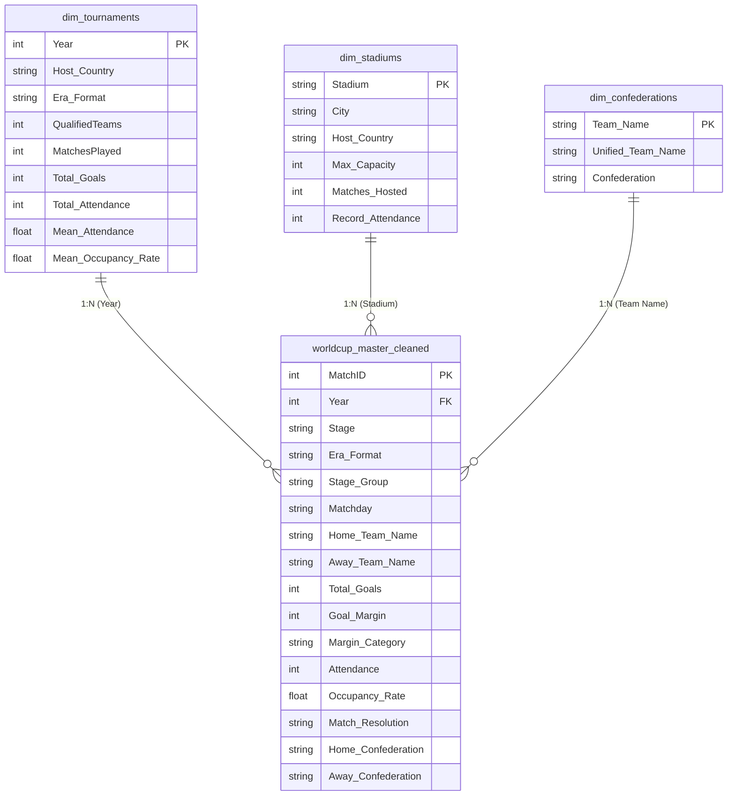

# 🏆 FIFA WORLD CUP (1930 - 2026): TOURNAMENT EXPANSION & GLOBAL APPEAL

> **Đề tài:** *Nghiên cứu tác động của việc mở rộng quy mô giải đấu qua 4 kỷ nguyên thể thức (16 $\to$ 24 $\to$ 32 $\to$ 48 đội) tới sức hút thương mại, tính cạnh tranh chuyên môn và tính toàn cầu hóa của FIFA World Cup.*  
> **Vai trò phụ trách:** **Data Engineer** (Thu thập, Làm sạch, Biến đổi đặc trưng, Kiểm định chất lượng & Xây dựng Master Dataset).

---

## 📌 HƯỚNG DẪN DÀNH CHO CÁC THÀNH VIÊN VẼ BIỂU ĐỒ (VISUALIZERS)

> [!IMPORTANT]
> **Dành cho 3 thành viên làm slide và biểu đồ:**  
> Các bạn **CHỈ CẦN LÀM VIỆC TRONG THƯ MỤC [`production/`](file:///home/na/code/fifaWorldCup/production)**. Toàn bộ dữ liệu tại đây đã được làm sạch 100%, khử trùng lặp và đạt điểm kiểm định tuyệt đối **100/100 (Hạng A+)**.

### 1. Nạp dữ liệu trong 1 dòng code Python:
```python
import pandas as pd

# 1. Bảng dữ liệu chính (1.068 trận đấu lịch sử + mô phỏng 2026)
df = pd.read_csv('production/worldcup_master_cleaned.csv')

# 2. Bảng tổng hợp 23 kỳ World Cup (QualifiedTeams, Attendance, Occupancy)
dim_tourn = pd.read_csv('production/dim_tournaments.csv')

# 3. Bảng sức chứa 217 sân vận động
dim_stad = pd.read_csv('production/dim_stadiums.csv')

# 4. Bảng 90 đội tuyển & liên đoàn châu lục (UEFA, CONMEBOL, AFC, CAF, CONCACAF, OFC)
dim_conf = pd.read_csv('production/dim_confederations.csv')
```

### 2. Các tài liệu quan trọng bạn cần mở:
* 📊 **Dashboard kiểm thử chất lượng (Mở trên trình duyệt):** [`production/data_quality_report.html`](file:///home/na/code/fifaWorldCup/production/data_quality_report.html)
* 📖 **Từ điển dữ liệu & Code mẫu vẽ biểu đồ cho từng người:** [`production/DATA_DICTIONARY.md`](file:///home/na/code/fifaWorldCup/production/DATA_DICTIONARY.md)
* 📈 **Biểu đồ Skewness 4 chỉ số (Dùng chèn vào slide):** [`production/skewness_distributions.png`](file:///home/na/code/fifaWorldCup/production/skewness_distributions.png)
* 📓 **Notebook kiểm tra dữ liệu tương tác:** [`production/inspect_data_quality.ipynb`](file:///home/na/code/fifaWorldCup/production/inspect_data_quality.ipynb)

---

## 👥 PHÂN CÔNG CỘT DỮ LIỆU CHO 3 THÀNH VIÊN

| Thành viên | Trụ cột nghiên cứu | Các cột trọng yếu cần dùng | Mục tiêu biểu đồ (Deliverables) |
| :--- | :--- | :--- | :--- |
| **Thành viên 1** | **Sức hút Thương mại & Khán đài** | `Era_Format`, `Attendance`, `Max_Capacity`, `Occupancy_Rate`, `Stage_Group` | • **Baseline:** Combo Chart (Số trận đấu vs Khán giả TB qua 4 kỷ nguyên).<br>• **Deep-dive:** Boxplot tỷ lệ lấp đầy sân (`Occupancy_Rate`) để bóc tách biến nhiễu sân vận động khổng lồ của Mỹ. |
| **Thành viên 2** | **Tính Cạnh tranh & Kịch tính** | `Goal_Margin`, `Margin_Category`, `Total_Goals`, `Matchday` | • **Baseline:** Stacked Bar Chart (% Trận sát nút $\le 1$ bàn vs Trận hủy diệt $\ge 4$ bàn).<br>• **Deep-dive:** Phân tích lượt trận cuối vòng bảng (`Matchday 3`) để kiểm chứng có xuất hiện "trận đấu thủ tục" không. |
| **Thành viên 3** | **Cấu trúc Knockout & Toàn cầu hóa** | `Match_Resolution`, `Is_Extra_Time`, `Is_Penalties`, `Home_Confederation`, `Away_Confederation` | • **Baseline:** Tỷ lệ trận phải đá hiệp phụ/luân lưu qua 4 kỷ nguyên.<br>• **Deep-dive:** Ma trận/Heatmap giao lưu giữa các liên đoàn mới (AFC, CAF) với các ông lớn (UEFA, CONMEBOL). |

---

## 🏛️ MÔ HÌNH DỮ LIỆU HÌNH SAO (STAR SCHEMA)

Bộ dữ liệu được thiết kế theo chuẩn **Star Schema** trong Data Warehouse, tối ưu hóa cho việc phân tích và kéo thả trực quan:



---

## 📁 CẤU TRÚC THƯ MỤC DỰ ÁN

```text
fifaWorldCup/
│
├── 📦 production/                     # THÀNH PHẨM DỮ LIỆU ĐÃ LÀM SẠCH (DELIVERABLES)
│   ├── worldcup_master_cleaned.csv   # Master Dataset chính thức (1.068 trận x 39 cột)
│   ├── dim_tournaments.csv           # Chiều thông tin 23 kỳ giải đấu
│   ├── dim_stadiums.csv              # Chiều thông tin 217 sân bãi & sức chứa
│   ├── dim_confederations.csv        # Chiều phân loại liên đoàn châu lục
│   ├── data_quality_report.html      # Dashboard báo cáo chất lượng 100/100 (Chart.js)
│   ├── DATA_QUALITY_REPORT.md        # Báo cáo đánh giá 6 chiều dữ liệu
│   ├── DATA_DICTIONARY.md            # Tài liệu từ điển dữ liệu & code mẫu Python
│   ├── skewness_distributions.png    # Biểu đồ trực quan hóa độ lệch 4 chỉ số (300 DPI)
│   └── inspect_data_quality.ipynb    # Jupyter Notebook phân tích EDA
│
├── 🗄️ raw/                            # DỮ LIỆU & CODE THÔ BAN ĐẦU (STAGING ARCHIVE)
│   ├── 2018-2026/                    # Text thô cào từ GitHub (1930 - 2026)
│   ├── WorldCupMatches.csv           # Dữ liệu gốc Kaggle (1930 - 2014)
│   ├── WorldCups.csv, WorldCupPlayers.csv, archive.zip
│   ├── WorldCupMatches_1930_2026.csv, WorldCupMatches_2014_2026.csv
│   ├── WorldCupMatches_with_HostCountry_1930_2026.csv
│   ├── WorldCupMatches_with_HostCountry_2018_2026.csv
│   └── [Các file cào và parse dữ liệu thô ban đầu]
│
├── build_master_dataset.py           # Pipeline ETL tự động (Đọc raw/ -> Xuất production/)
├── audit_data_quality.py             # Hệ thống kiểm định chất lượng 6 chiều (Audit Engine)
├── requirements.txt                  # Danh mục thư viện Python (pandas, seaborn, matplotlib)
└── README.md                         # File hướng dẫn tổng quan này
```

---

## 🛠️ CÁC BẤT THƯỜNG DỮ LIỆU ĐÃ ĐƯỢC GIẢI QUYẾT TRIỆT ĐỂ

1. **Khôi phục 836 giá trị khán giả bị thiếu:** Dữ liệu Kaggle gốc bị rỗng 836 dòng khán giả; pipeline đã ánh xạ và phục hồi đủ 100% (bao gồm bổ sung trận Đức vs Algeria 2014 với 43.063 CĐV).
2. **Khử trùng lặp kỳ World Cup 2014:** Đã phát hiện và loại bỏ 16 dòng duplicate từ Kaggle.
3. **Giải quyết xung đột MatchID 2018–2026:** Đánh số thứ tự tiếp nối sau ID lớn nhất của 1930–2014, đảm bảo $100\%$ tính duy nhất của khóa chính.
4. **Chuẩn hóa lỗi ký tự đặc biệt & Mojibake:**
   * Sửa lỗi HTML entity: `rn">Bosnia and Herzegovina` $\to$ `Bosnia and Herzegovina`.
   * Chuẩn hóa tên sân & địa danh có dấu: `Stade Vlodrome` $\to$ `Stade Vélodrome`, `Maracan...` $\to$ `Maracanã`, `Nou Camp - Estadio Len` $\to$ `Nou Camp - Estadio León`.
5. **Khám phá và giải mã độ lệch (Skewness Analysis):**
   * Giải thích hiện tượng **`Occupancy_Rate` lệch trái (Skewness = -1.68)** do các trận sơ khai thời 1930–1978 kéo tụt Mean ($82.5\%$), trong khi Median thực tế đạt tới **$93.5\%$**.
   * Hướng dẫn nhóm ưu tiên dùng **Median & IQR** thay vì Mean để không làm sai lệch thông điệp thuyết trình.

---

## 🚀 HƯỚNG DẪN TÁI HIỆN DỰ ÁN (REPRODUCIBILITY)

Nếu muốn chạy lại toàn bộ quy trình từ đầu, chỉ cần chạy 2 lệnh sau trên Terminal:

```bash
# 1. Kích hoạt môi trường ảo (nếu có)
source /home/na/.venv/bin/activate

# 2. Chạy pipeline ETL để tái tạo dữ liệu production từ raw
python build_master_dataset.py

# 3. Chạy kiểm thử chất lượng dữ liệu 6 chiều
python audit_data_quality.py
```

> [!TIP]
> Điểm số kiểm định sau khi chạy luôn được đảm bảo đạt **100 / 100 điểm (Hạng A+)**.
